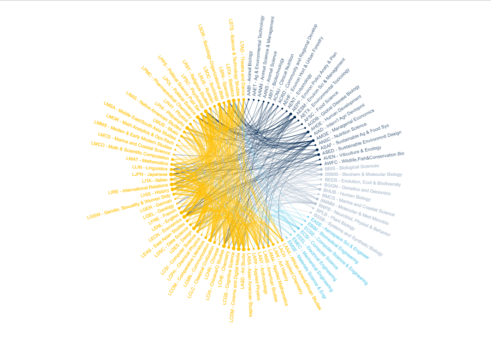
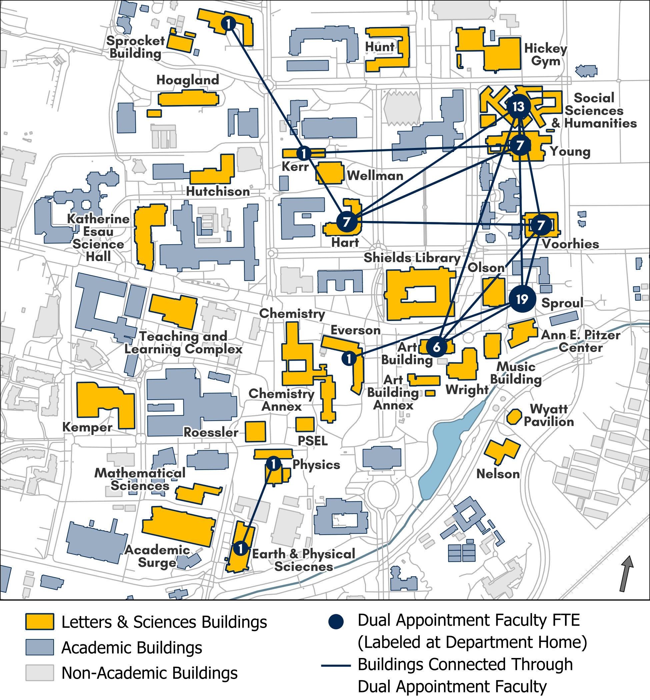
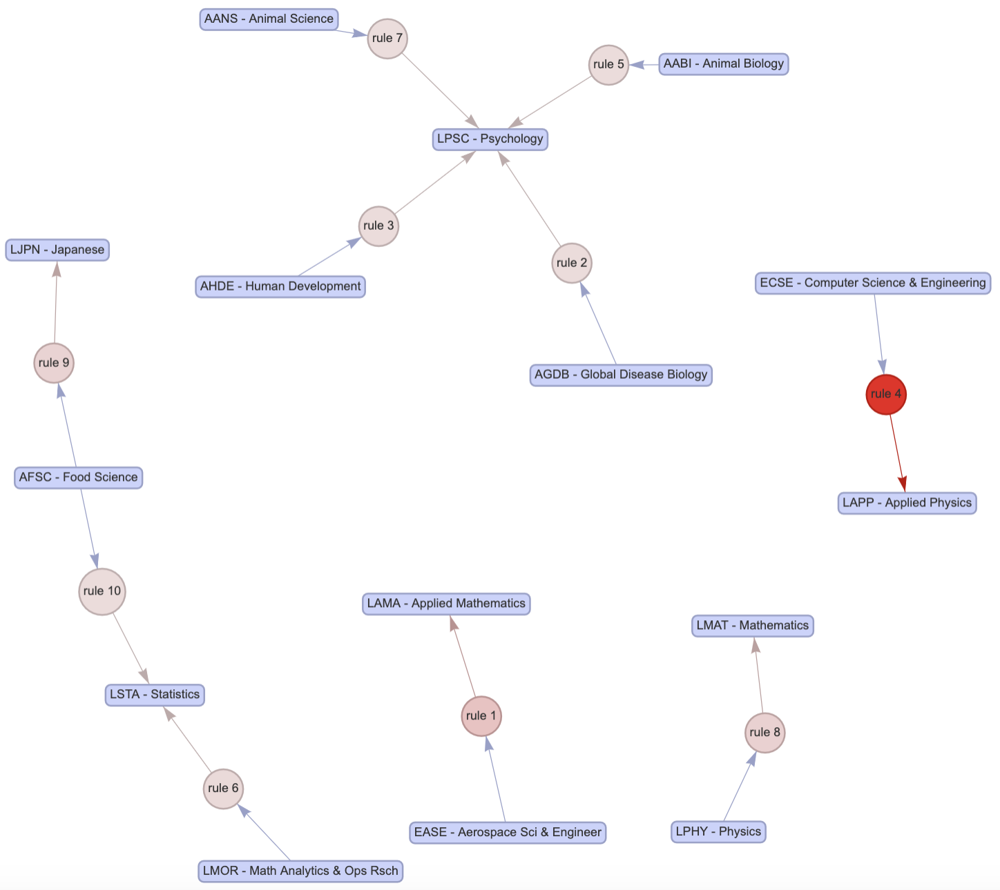
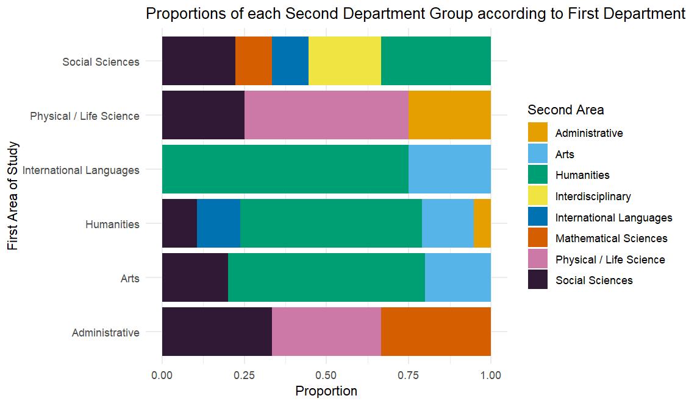

# Strategic-Planning-Project-Viz

## Overview

This project explores interdisciplinary education and research at the University of California, Davis. Using **R**, university-provided datasets, and information collected from UC Davis websites, the analysis examines connections among undergraduate majors and minors, faculty appointments, and graduate groups.

The goal was to turn these relationships into clear visualizations that could inform discussions about **strategic planning, resource allocation, and opportunities for interdisciplinary collaboration** within the College of Letters & Science.

## Research Questions

- Which undergraduate majors are frequently combined, and how often do students double-major across colleges?
- How did enrollment in academic minors change between **2018–2019 and 2022–2023**?
- How are faculty appointments and graduate-group affiliations distributed across departments and colleges?
- What patterns might help identify opportunities for interdisciplinary programs and research?

## Methods & Tools

- **Data collection:** Combined university-provided records with information collected from official university websites, including graduate-group and program pages.
- **Data preparation:** Cleaned and standardized program, department, and college information; joined datasets for comparative analysis.
- **Statistical analysis:** Used descriptive statistics, enrollment proportions, and Apriori association-rule mining to explore patterns in double majors.
- **Visualization:** Created bar charts, association-rule graphs, and department/college comparisons to communicate findings.

**Tech stack:** R, RStudio, tidyverse, dplyr, ggplot2, readxl, arules, arulesViz, rvest, stringr, httr, xml2, igraph, ggraph.

## Key Findings

- **Double majors:** Students in the College of Letters & Science who pursued a second major most often chose another major within the same college. Among second majors outside the college, Agricultural & Environmental Sciences appeared most frequently.
- **Major combinations:** Association-rule analysis highlighted recurring major pairings using support, confidence, and lift. These are descriptive associations, not a validated prediction model.
- **Degree requirements:** Majors with fewer required units tended to have higher double-major rates in the analyzed data. This is an observed association, not evidence of causation.
- **Minor enrollment:** Overall participation in minors increased between 2018–2019 and 2022–2023, but growth varied substantially by program and college.
- **Research connections:** Faculty appointments and graduate-group memberships revealed differences in cross-department and cross-college representation, with potential opportunities for interdisciplinary collaboration.

## Featured Visualizations

### 1. Mapping the Connections Between Double Majors



This circular network maps pairings involving at least one College of Letters & Science major. Colors distinguish colleges, while connecting lines reveal the breadth of within-college and cross-college double-major combinations.

### 2. Faculty Connections Across the UC Davis Campus



A campus-level map of buildings linked through faculty dual appointments. Highlighted buildings, connection lines, and appointment counts illustrate where interdisciplinary connections are concentrated, particularly around major Letters & Science hubs.

### 3. Discovering Major Associations with Apriori



**Association-rule mining** uncovers recurring combinations of undergraduate majors. The graph connects majors through rules evaluated using support, confidence, and lift, revealing interesting patterns without treating those associations as predictions.

### 4. Where Faculty Disciplines Overlap



This colorful comparison shows how faculty members' secondary departmental appointments span different fields relative to their primary area of study. It highlights differences in cross-disciplinary representation across academic areas.

More figures—including enrollment trends, graduate-group representation, and major-level comparisons—are available in [`data_visualizations/`](data_visualizations/). Figure descriptions and data sources are documented in [`Data Visualizations Documentation.pdf`](Data%20Visualizations%20Documentation.pdf).


## Repository Structure

```text
.
├── R/                                  # R scripts for data collection, cleaning, analysis, and plotting
├── Data/                               # Project reference data and derived datasets
├── data_visualizations/               # Saved figures and charts
├── Data Visualizations Documentation.pdf
└── README.md
```

## Data & Reproducibility Notes

The project used a combination of publicly available university information and university-provided datasets. **Some original source files are not included** in this repository. As a result, not every R script can be run end-to-end using only the files here; some also require updated file paths or dependencies.

The visualizations represent the data available during the **2024 project**, rather than current university statistics. Findings are exploratory and intended to support further investigation, not to establish causal relationships or prescribe individual resource-allocation decisions.
